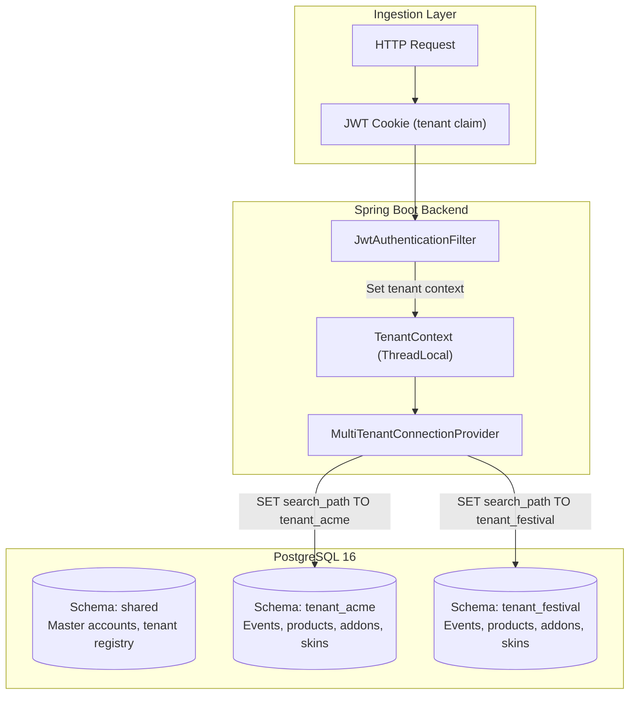
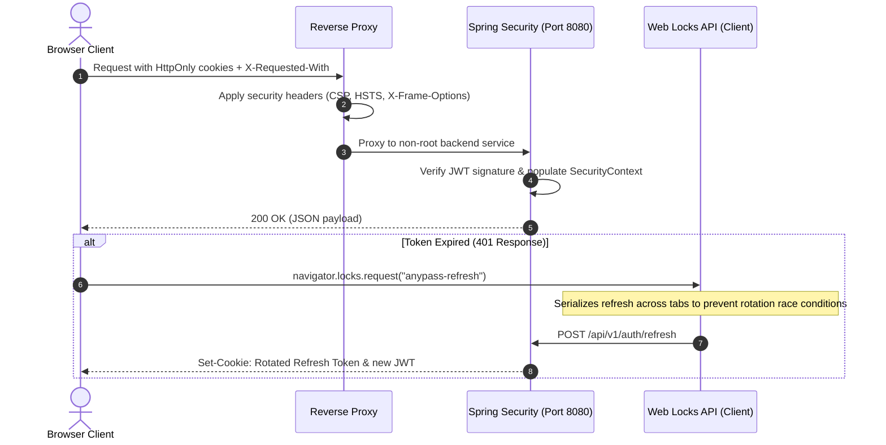
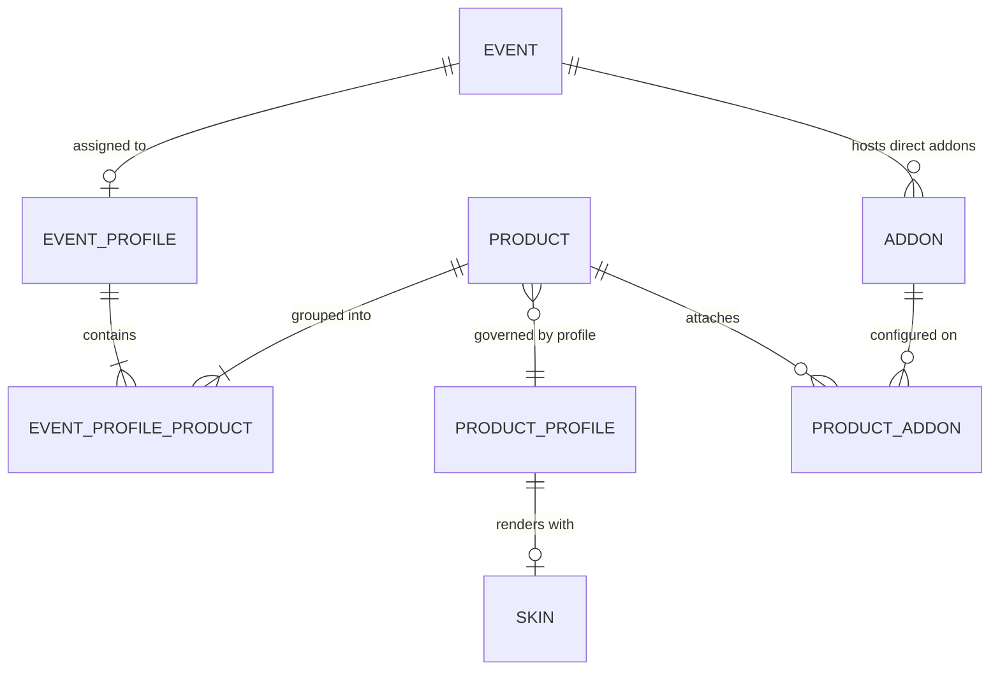

# SaaS Ticketing & Event Management Platform

Architecture and system design specification for a multi-tenant ticketing and event management backend.

This repository documents the architectural patterns, database schemas, security lifecycle, and technical decisions implemented in the platform. The application source code is maintained in a private repository; this repository serves as a technical design reference.

---

## Technical Overview

The system is a multi-tenant backend responsible for event scheduling, quota-controlled ticket issuance, pricing profiles, and access control. 

### Core Tech Stack
- **Language / Runtime:** Java 25
- **Framework:** Spring Boot 4.0
- **Database:** PostgreSQL 16
- **Persistence & Migrations:** Spring Data JPA / Hibernate, Flyway
- **Security:** Spring Security, Stateless JWT, OWASP ASVS Level 2
- **Testing:** Postman / Newman CLI, JUnit 5, Mockito

---

## Architecture

### Multi-Tenant Schema Isolation

Data isolation is implemented at the database catalog level using PostgreSQL schemas (Schema-per-Tenant), avoiding shared-table row filtering via discriminator columns.

Details: [docs/architecture/multi-tenancy-architecture.md](docs/architecture/multi-tenancy-architecture.md)

---

### Request & Authentication Pipeline

Authentication and session control are aligned with OWASP ASVS Level 2 and Level 3 verification requirements.

Details: [docs/architecture/security-pipeline.md](docs/architecture/security-pipeline.md)

---

### Domain Model

Events, ticket products, and visual render templates (skins) are decoupled through profile entities to support series scheduling and reusable commercial profiles.

Details: [docs/architecture/domain-model-erd.md](docs/architecture/domain-model-erd.md)

---

## Architectural Decisions

Specific engineering trade-offs are documented as Architectural Decision Records:

- **[ADR-001: Schema-per-Tenant Multi-Tenancy Strategy](docs/adr/ADR-001-multi-tenancy-schema-isolation.md)**  
  Comparison of discriminator column vs. schema isolation vs. separate database instances in PostgreSQL.

- **[ADR-002: Financial-Grade Soft Delete & Foreign Key Handling](docs/adr/ADR-002-financial-soft-delete-hibernate.md)**  
  Implementation of non-destructive soft delete for financial audit compliance and resolving Hibernate `@ManyToMany` join table hydration issues using `@NotFound(action = IGNORE)`.

- **[ADR-003: OWASP ASVS Compliance & Session Security Lifecycle](docs/adr/ADR-003-owasp-asvs-security-controls.md)**  
  Defense-in-depth against XSS token exfiltration, CSRF mitigations, cross-tab refresh race conditions, and fragment-based token transmission.

---

## API Specification

The REST API interface is fully documented using OpenAPI 3.0:
- **Interactive Documentation (Live Swagger UI):** [https://jasperbta.github.io/saas-ticketing-event-management/](https://jasperbta.github.io/saas-ticketing-event-management/)
- Raw specification file: [`docs/openapi/openapi.yaml`](docs/openapi/openapi.yaml)

---

## Testing & Verification

Integration and regression testing are automated against a running environment via the Newman CLI test runner:
- Multi-suite coverage across authentication, authorization, event scheduling, quota management, and soft-delete restrictions.
- Test runner script: `./test-api.sh` executing collections against isolated tenant schemas.

---

## Contact

**Kamil Oleksiak**  
Java / Backend Engineer  
Project walk-through and technical demonstrations available upon request.
