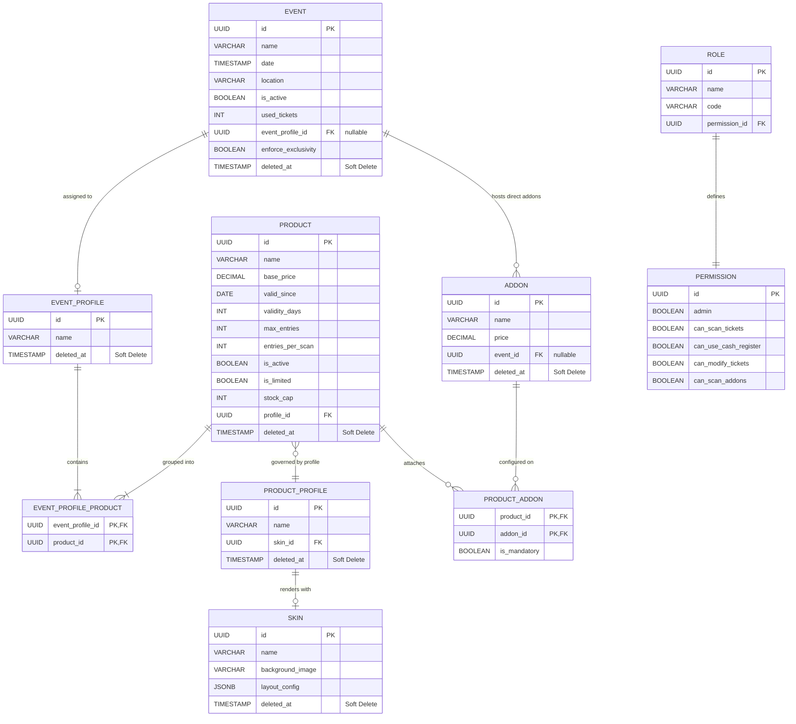

# Core Domain Model (Entity Relationship Diagram)

The **SaaS Ticketing & Event Management platform** separates the concept of a **Physical Event**, a **Ticket Product**, and a **Visual Ticket Template (Skin)** into decoupled, composable entities.

## Entity-Relationship Diagram (ERD)

## Architectural Design Highlights

1. **Decoupled Ticket Profiles (`EventProfile` & `ProductProfile`):**
   - Products are not hard-wired directly to single events. Instead, an `EventProfile` groups multiple ticket products that can be assigned across recurring event series.
   - A `ProductProfile` decouples the commercial configuration of a ticket from its graphical representation (`Skin`).
2. **Strict Financial Soft Delete:**
   - Entities involved in transactions (`Event`, `Product`, `Addon`, `Skin`) use `@SQLDelete` and `@SQLRestriction("deleted_at IS NULL")`.
   - Records with `salesCount > 0` or `usedTickets > 0` are protected by a business rule forbidding permanent purge to guarantee accounting integrity.
3. **Hibernate `@NotFound(action = IGNORE)` Pattern:**
   - Avoids `EntityNotFoundException` on join tables (`EVENT_PROFILE_PRODUCT`, `PRODUCT_ADDON`) when traversing historical records linked to soft-deleted items.

