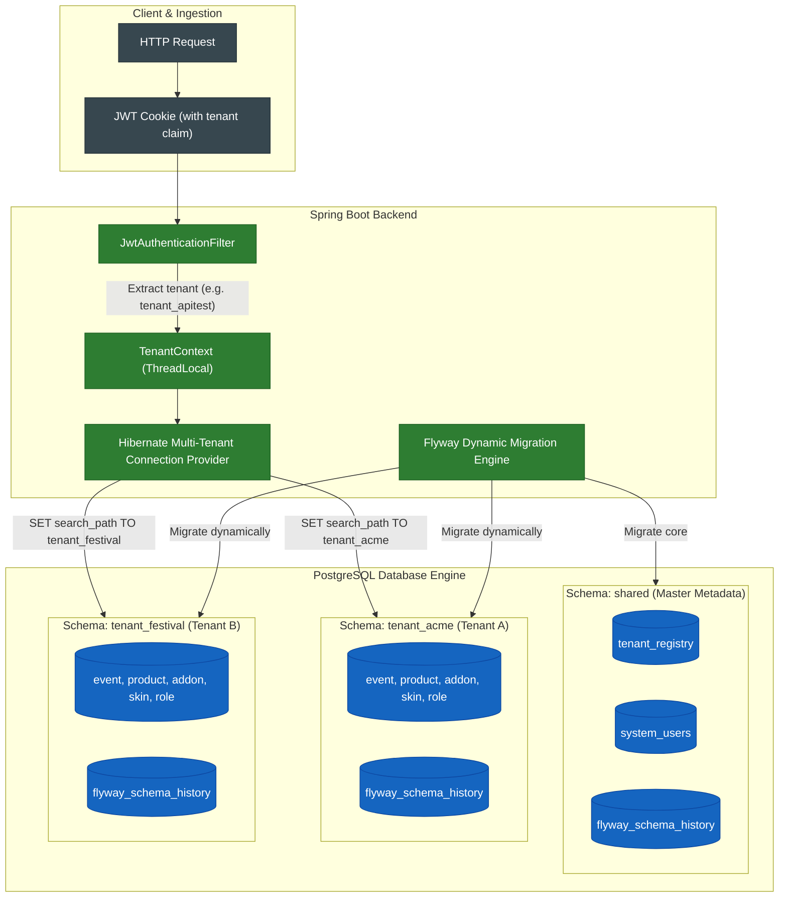

# Multi-Tenant Architecture (Schema-per-Tenant)

The **SaaS Ticketing & Event Management platform** *(codename: AnyPass)* utilizes a **Schema-per-Tenant** multi-tenancy model on top of PostgreSQL. This approach guarantees strong physical data isolation between organizers without the financial overhead of provisioning separate database instances.

## Architectural Overview

## Key Engineering Highlights

1. **Physical Isolation vs Discriminator Column:**
   - Instead of appending `WHERE tenant_id = ?` to every SQL query (which is prone to catastrophic developer oversights and data leaks), PostgreSQL schemas isolate tables at the database catalog level.
2. **Automated Dynamic Schema Migrations:**
   - On application startup and upon provisioning a new organizer, Flyway executes tenant migrations dynamically across all registered schemas (`V1__tenant_init.sql`).
3. **No Cross-Tenant Data Bleed:**
   - Connection pools dynamically set the schema search path for the duration of the current transaction and reset it upon connection return to HikariCP pool.

