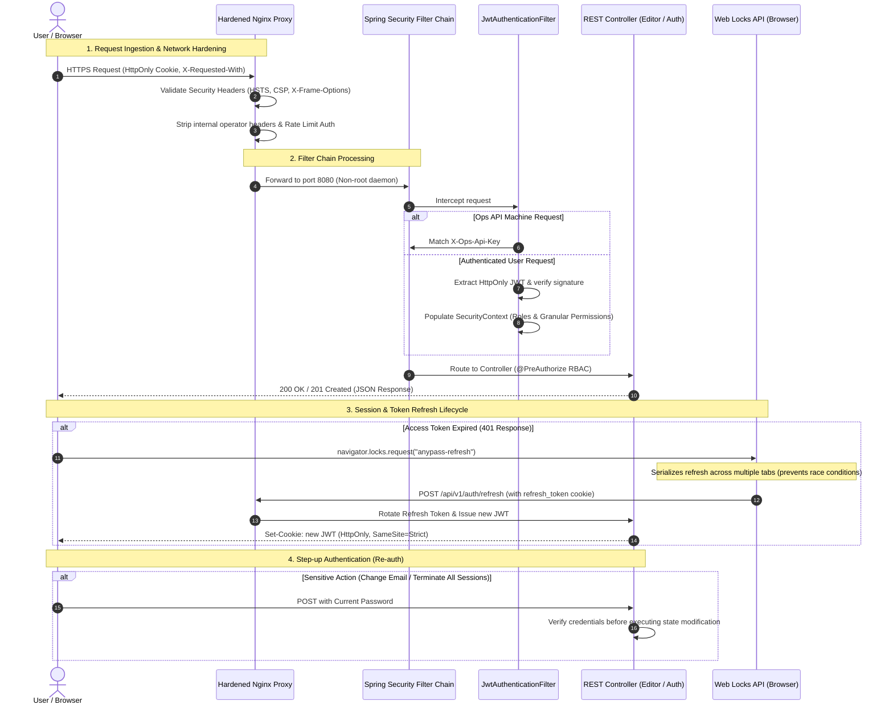

# Security & Request Pipeline (OWASP ASVS Compliance)

The **SaaS Ticketing & Event Management platform** *(codename: AnyPass)* implements security controls aligned with **OWASP ASVS (Application Security Verification Standard) Level 2 & 3**.

## Security Flow Architecture

## Security Controls Summary

| Security Control | Implementation Detail | ASVS Objective |
|---|---|---|
| **Token Storage** | `HttpOnly`, `SameSite=Strict`, `Secure` cookies | Complete mitigation of XSS token exfiltration |
| **CSRF Defense** | Custom header check (`X-Requested-With`) + Strict SameSite cookies | Defense-in-depth against cross-site forged requests |
| **MFA Verification** | 6-digit cryptographic OTP via email with strict time expiry | Credential compromise mitigation |
| **Token Leakage Defense** | Activation & reset tokens delivered via URL fragment (`#token=...`) | Eliminates leakage in Server Access Logs & `Referer` headers |
| **Race-Condition Defense**| `navigator.locks` Web Locks API for token rotation | Eliminates simultaneous refresh collisions across browser tabs |
| **Input Validation** | Strict `maxLength` bounds on all endpoints and DTOs | Buffer overrun & DoS mitigation |

